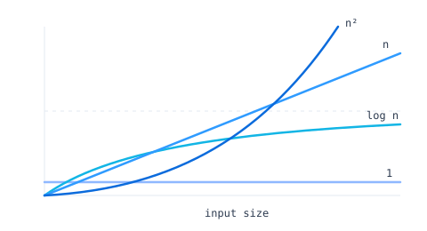

# Big O notation

Big O describes how the running time of an algorithm grows as its input grows. It ignores constants and keeps the dominant term.

Formally, $f(n) = O(g(n))$ when there are constants $c > 0$ and $n_0$ such that $f(n) \le c \cdot g(n)$ for every $n \ge n_0$.

## The usual suspects

| Complexity | Name | Example |
| --- | --- | --- |
| $O(1)$ | Constant | Reading an array element |
| $O(\log n)$ | Logarithmic | Binary search |
| $O(n)$ | Linear | One pass over a list |
| $O(n \log n)$ | Linearithmic | Merge sort |
| $O(n^2)$ | Quadratic | Comparing every pair |
| $O(2^n)$ | Exponential | Trying every subset |



## Reading it from code

```java
// O(n^2): the inner loop runs n times for each of the n outer steps
for (int i = 0; i < n; i++) {
    for (int j = 0; j < n; j++) {
        count += grid[i][j];
    }
}
```

```ts
// O(n): a Set makes each lookup constant time
function hasDuplicate(values: number[]): boolean {
  const seen = new Set<number>();
  for (const value of values) {
    if (seen.has(value)) return true;
    seen.add(value);
  }
  return false;
}
```

> [!NOTE]
> Big O is an upper bound. An algorithm that is $O(n)$ is also $O(n^2)$, the tighter bound is just more useful.
