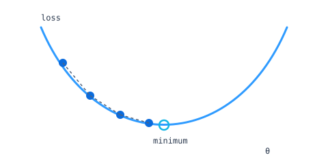

# Gradient descent

Gradient descent minimises a function by repeatedly stepping against its gradient.

## The update rule

For parameters $\theta$, loss $L$ and learning rate $\eta$:

$$
\theta_{t+1} = \theta_t - \eta \, \nabla_\theta L(\theta_t)
$$



> [!TIP]
> If the loss bounces around or grows, the learning rate is too high. Halve it and try again.

## Variants

| Variant | Uses per step | Trade-off |
| --- | --- | --- |
| Batch | The whole dataset | Stable but slow |
| Stochastic | One example | Fast but noisy |
| Mini batch | A small batch | The usual middle ground |

## In code

```python
import numpy as np

def gradient_descent(X, y, lr=0.01, epochs=500):
    w = np.zeros(X.shape[1])
    for _ in range(epochs):
        error = X @ w - y
        gradient = X.T @ error / len(y)
        w -= lr * gradient
    return w
```

> [!NOTE]
> For linear regression with mean squared error the loss is convex, so gradient descent finds the global minimum.
